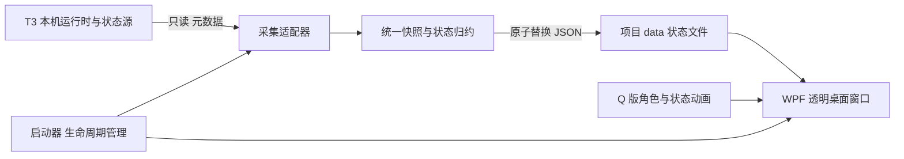

# Rebecca T3 Pet — 完整开发规格 v0.1

状态：实施基线。用户已授权参考资料收集、Mugglen 私有仓库、spec、GitHub tickets 和后续实现。

## 1. 目标与范围

在 Windows 桌面提供 Q 版动漫瑞贝卡，用动作与简短文字表达本机 T3 Code 的真实工作状态。用户应能快速知道“还在工作”“有问题等我回复”“这一轮完成了”“连接失效”，而无需一直查看 T3 窗口。

v0.1 交付可运行的本机原型、启动/停止入口、真实状态适配、角色显示、自动测试及实机验证记录。v1.0 的完成定义还包含逐状态动画资产、人机交互验收、跨设备便携配置和发布包。两者不混称完成。

首版不包含独立聊天模型、语音克隆、任务审批代理、自动修复 T3、开机自启、远程账号接入。桌宠不执行用户的编程任务。

## 2. 已确认与产品默认值

- 用户确认：瑞贝卡、Q 版动漫风、监控 T3 Code、类似 Codex 桌宠的陪伴体验。
- 默认监控本机所有未归档、未删除、未收起的顶层活动线程；子代理通过父任务语义体现，避免重复计数。范围过滤必须明确显示。
- 默认无声音、不抢输入焦点、保持置顶；可拖动、缩放、暂停动作并退出。
- 默认刷新目标为 2 秒；以实测采集成本决定实际间隔。任意单次采集必须有超时和大小边界。
- 角色显示与采集失败相互隔离；查询时不冻结桌面交互。

## 3. 用户故事与功能要求

| 编号 | 要求 | 验收证据 |
| --- | --- | --- |
| F01 | 本机活动任务聚合，并可配置项目范围 | 多任务 fixture 与真实查询比较 |
| F02 | 区分准备、排队、执行和后台等待，归为工作状态 | 状态机测试 |
| F03 | 请求提示与运行状态独立；异步提问期间可以继续工作 | blocking=true/false/unknown 三类测试 |
| F04 | 新成功、失败、中断、取消、回滚分别处理 | runId 转换测试，不重复庆祝 |
| F05 | 启动/重连只建立基线，不回放旧任务完成 | 启动、重连和快速新 run 测试 |
| F06 | 断连、过期、不兼容明确显示，绝不默认为空闲 | 假运行时、超时、坏 JSON 和变更 schema 测试 |
| F07 | 透明无边框角色、短提示、右键菜单、拖动与退出 | Windows 窗口实测 |
| F08 | 角色动作受状态驱动，降低动态模式可用 | 每个状态的演示与暂停检查 |
| F09 | 保持位置、尺度和安静偏好；离屏位置可恢复 | 配置损坏、多屏及 DPI 检查 |
| F10 | 只读访问 T3 元数据，运行数据和素材全部在 D 盘 | 查询审查、文件路径检查 |
| F11 | 单实例、退出清理采集进程、启动失败有可见错误 | 重复启动与停止检查 |
| F12 | demo 与 live 始终可区分，演示不篡改真实快照 | 两种启动方式和来源标记 |

## 4. 状态模型

“执行”和“需要注意”采用两个维度。没有可靠字段时显示未知，不能猜测。

| 原始状态/信号 | 执行分类 | 注意事项 |
| --- | --- | --- |
| preparing/queued/starting/running | working | 保留原始阶段 |
| waiting + 后台/子任务等待 | working | 不提示用户审批 |
| pending request, blocking=false | 保持运行分类 | 显示有待回复角标 |
| 明确用户阻塞请求 | waiting_user | 提醒用户返回 T3 |
| pending request, blocking 未知 | 保持原执行分类 | 显示待处理，不断言停止 |
| completed | terminal_success | 只在新 run 转换时短暂庆祝 |
| failed | terminal_failure | 与成功区分 |
| interrupted/cancelled/rolled_back | terminal_stopped | 不庆祝成功 |
| 无活动 | idle | 保留近期事件短提示 |
| 不可达/陈旧/结构不兼容 | unavailable | 优先覆盖其他展示 |

展示优先级：不可用 > 明确需用户操作 > 新失败 > 活动任务 > 新成功/停止 > 空闲。异步请求角标和总计独立存在。可用性优先级始终最高；历史失败不永久盖住新任务。

事件以 `(thread_id, run_id, terminal_status)` 去重；状态发生在本轮连接之后才发出。第一次快照、切换监控范围、服务启动标识变化、断连后恢复均重建基线。未曾观察到运行的新 run 若时间晚于基线，仍应识别快速完成。事件展示建议 5 秒，后续快照保持事件 ID 不抖动。

## 5. 组件架构



候选实现：Python 3.12+ 标准库处理采集、状态机与 JSON；Windows PowerShell 5.1/WPF 实现窗口，无额外 GUI 安装。Python 路径可配置，当前机器可使用 `D:\Projects\.venv\Scripts\python.exe`，不能将其当作其他机器必然存在的路径。

数据源决策见 [架构决策](ARCHITECTURE.md)。T3 CLI/MCP 优先评估；若公开输出无法满足请求语义或频繁调用成本过高，采用显式版本适配的只读 SQLite + 本机服务健康检查。禁止读取聊天表、请求正文、命令内容、凭证或完整错误栈。

## 6. 显示快照契约

UTF-8 JSON，`schema_version=1`；读者必须拒绝不支持的版本。必需的 UI 字段如下，Python 内部数据结构可增加但不能让 UI 依赖私有数据库字段：

```json
{
  "schema_version": 1,
  "observed_at": "2026-11-25T00:00:00Z",
  "mode": "live",
  "state": "working",
  "message": "正在处理 2 个任务",
  "source": {"kind": "t3-local", "version": "0.1.11", "health": "connected"},
  "counts": {"working": 2, "waiting_user": 0, "pending": 1, "failed": 0},
  "event": null
}
```

`state`：`idle / working / attention / success / error / stopped / offline / incompatible`。`event` 若存在，至少有 `id`、`kind`，不得含聊天或命令文本。`mode`：`live / demo`。`source.health`：`connected / disconnected / error / incompatible`。

采集端原子写入，防止半截 JSON。UI 每次读取有大小上限；文件缺失、坏 JSON 或超过 `max(3 * poll_seconds, 10)` 秒未更新时显示不可用。陈旧判断独立于进程存活。正常读取失败保留上一次角色但切换到不可用提示，不能将旧 working 当作当前状态。

## 7. 角色与动画资产

参考来源、来源等级、原图哈希与用途见 `references/manifest.json` 和 `references/INDEX.md`，美术约束见 [ART-DIRECTION.md](ART-DIRECTION.md)。原始参考不作为运行时资产。

正式生成或绘制的资产放 `assets/`，记录生成提示、来源版本和加工方式。透明 RGBA PNG、固定画布、统一足底锚点、不裁切发梢与手部；若采用图集，附明确网格和帧序索引。

v0.1 至少有一张正式 Q 版角色与明确状态动画/标记；v1.0 扩为 idle、working、attention、success、error、stopped、offline、drag 八个状态，包含眨眼/呼吸或多帧变化。不能将单图位移声称为逐帧角色动画。

## 8. 窗口与交互

- 初始角色高度建议 220–280 DIP；缩放范围 0.6–1.6，保留可读提示。
- 角色与小型状态牌可点击，透明区域的鼠标行为实测后记录。
- 按下到移动超过系统拖动阈值才进入拖动；普通点击只显示摘要。
- 右键：状态详情、暂停动画、置顶切换、回到主屏、退出。Esc 可退出，但不注册全局键盘钩子。
- 每次开窗根据可见工作区校正位置，兼容负坐标；物理像素与 DIP 显式换算。
- 不自动弹到前台，不在每次轮询时重启动画或重播气泡。

## 9. 配置与生命周期

跟踪 `config.example.json`；机器配置为被忽略的 `config.local.json`。字段至少有 T3 home、Python 可执行文件、刷新间隔、项目过滤、缩放和是否置顶。路径验证需要拒绝 C 盘输出目录；读取已有 C 盘安装允许。

启动器设置 TEMP/TMP 到项目 `tmp/`，生成数据到 `data/`，日志到 `logs/`。仅保留自身 PID/启动标识，停止时只终止由本实例启动的进程，不能按 python/powershell 名称批量 kill。

启动器支持明确 live/demo 模式；demo 不访问 T3。锁/互斥量限制一个实例。关闭窗口会停止采集器并清理实例标记。异常日志限量轮转，不记录私有内容或原始数据库行。

## 10. 质量、验证和证据边界

- 自动测试：状态优先级、异步请求、阻塞未知、快速完成、重连、聚合、过期、损坏输入、schema 不匹配、只读数据库、原子写入及过滤。
- Windows smoke：创建窗口、解析角色素材、载入快照、持续刷新、退出清理。可自动构造快照检查，但需标为模拟。
- live 验证：本机运行任务计数与 T3 工具返回对照，记录版本、时间和采集耗时；不为验证去打断用户的真实工作。
- 人工验收：桌面视觉质量、不同显示缩放、多屏拖动、点击命中；未执行项目必须标 pending。
- CI：标准库单元测试与 Windows WPF 加载 smoke。测试 fixture 不含实际线程内容或凭证。
- 性能目标：采集 p95 < 500 ms（如采用 SQLite），UI 刷新不阻塞；idle CPU 目标 < 2%，内存目标 < 150 MB。没有测量不得宣称达标。

## 11. 发布与验收矩阵

发布说明写清支持的 T3 版本、启动方式、依赖、已验证场景、已知限制和回退方式。v0.1 不安装服务、不注册启动项；停止并删除项目运行数据即可撤销运行状态。

| 阶段 | 完成条件 |
| --- | --- |
| M0 规格 | 参考库、spec、架构决策、GitHub tickets 与可追溯关系 |
| M1 可运行原型 | F01–F08/F10–F12 核心实现，测试与 live 读取验证；人工未测项明确标注 |
| M2 完整桌宠 | F09 多屏/缩放验收、全状态美术、可复用配置、性能测量 |
| M3 发布 | 便携包、安装/升级/故障文档、完整验证报告 |

每个 ticket 必须有依赖、实施范围、验收条件和验证结果。提交关联 issue，PR 根据实际实现说明关闭哪些 ticket，未验收的不提前关闭。合并由用户决定。
